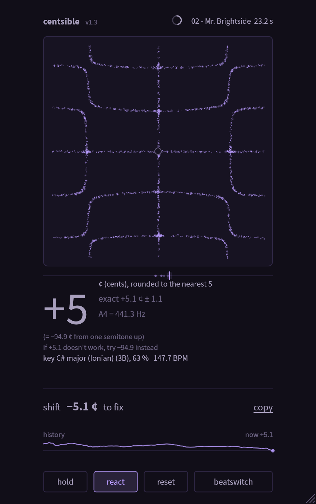
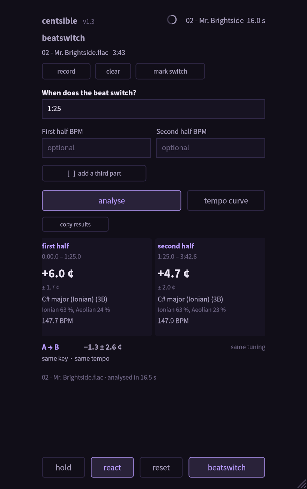
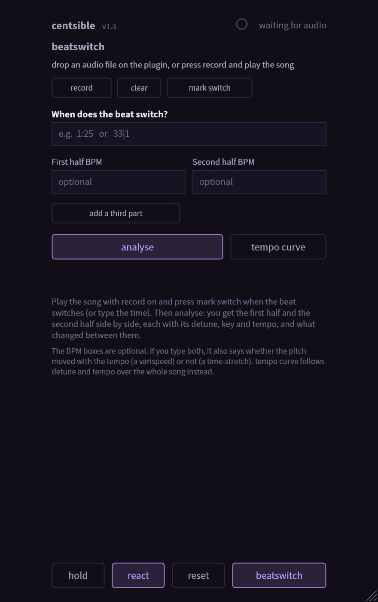
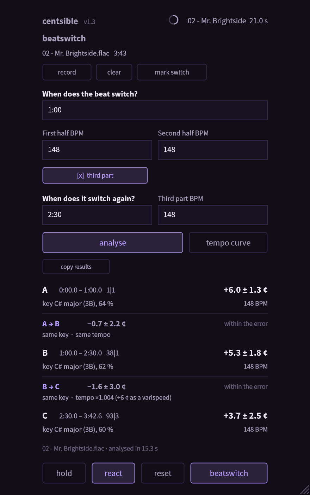
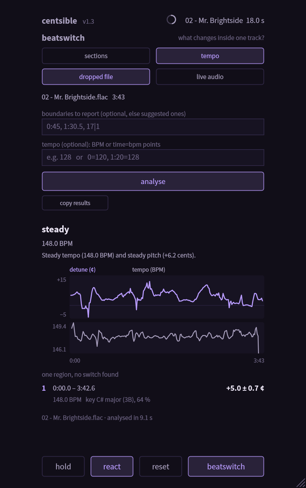

<div align="center">

# Centsible

**How far off A440 is this song, what key is it in, how fast is it, and what changes when the beat switches?**


 &nbsp;&nbsp; 

</div>

---

## What it does

Centsible listens to a track and reports, without ever changing the audio (the plugin's output is bit-identical to its input):

| | |
|---|---|
| **Tuning** | cents away from 12-TET A = 440 Hz, as a big number rounded to the nearest 5 ¢ and the exact value with its ± interval beside it. It tells you what to shift by to fix it, and also the other reading from the semitone below or above. |
| **Key** | the key with its Camelot code, how sure it is, the runner-up, and which of the **seven modes** (Ionian, Dorian, Phrygian, Lydian, Mixolydian, Aeolian, Locrian) it is. |
| **Tempo** | BPM in the 80 to 160 range DJs and producers use, with the half or double reading as the alternative. |
| **Beatswitch** | where a track changes (new beat, new key, new tempo) and what each half is: detune, key and tempo, side by side. |
| **Match** | drop two files and it tells you how to shift the second one to sit on the first. |

Drop an audio file on the plugin window to analyse it, or just play audio through it.

---

## Beatswitch: two halves, two answers

Some tracks change halfway. Press the **beatswitch** button (bottom right) and answer three questions:

<table>
<tr>
<td width="50%" valign="top">

1. **When does the beat switch?** Type a time (`1:25`) or a bar (`33|1`). Or press **record**, play the song in your DAW, and press **mark switch** at the moment it switches.
2. **First half BPM** and **Second half BPM**: optional. If you type both, it also tells you whether the pitch moved with the tempo (a **varispeed**) or not (a **time-stretch**).
3. **`[ ] add a third part`**: for the rare second switch. Tick it and two more boxes appear.

Press **analyse**. You get the first half and the second half **side by side**, each with its detune, key (and mode) and tempo, then what changed between them and what to shift by to match them.

**tempo curve** follows detune and tempo over the whole song instead, finds the switches itself, and **use as switches** turns them into the boxes above.

</td>
<td width="50%">



</td>
</tr>
</table>

<details>
<summary><b>More pictures</b>: three parts, and the tempo curve</summary>
<br>
 &nbsp; 
</details>

> [!NOTE]
> The same analysis runs on the command line (`centsible_cli --sections "1:25" track.flac`). Details in [BEATSWITCH.md](BEATSWITCH.md).

---

## Install

1. Download **`Centsible-Setup-1.3.0.exe`** from the [latest release](../../releases/latest) and run it. It installs the VST3, and optionally the Standalone app and the command line tool.
2. Close your DAW first (Windows cannot replace a plugin that is loaded), then rescan plugins.

> [!WARNING]
> The installer is not code-signed yet, so Windows shows "unknown publisher" the first time.

---

## How accurate is it? (honest numbers)

Measured on a catalog of 369 real songs, mostly dense modern mixes. Real songs have no ground truth for tuning, so the test shifts every song by exact amounts and checks that the reading moves by exactly that.

| | result |
|---|---|
| Synthetic songs of known tuning | max error **0.17 ¢**, mean 0.017 ¢ (1801 of 1811 cases within the target) |
| Real songs, shifted by exact amounts | **88 %** within 0.5 ¢; the interval the plugin reports contains the error in 96 % of cases |
| Where it fails | a few songs read a wrong tuning **13 to 15 ¢** away, because the same notes can be explained by another partial pattern |
| Key (songs it had never seen) | **45 %** exact, **72 %** right scale; the probability it shows is well calibrated |
| Tempo | **98 %** within 1 % of the tracker's BPM |

Full tables, what was tried and what failed: [REPORT.md](REPORT.md), section 8.

---

## Command line

```bat
centsible_cli track.flac                                  :: tuning, key (with modes), tempo
centsible_cli --csv results.csv folder\*.flac             :: a whole folder into one table
centsible_cli --match a.flac b.flac                       :: how to shift b to sit on a
centsible_cli --sections "1:25" track.flac                :: Beatswitch: the two halves
centsible_cli --automation track.flac                     :: detune over time against tempo over time
```

---

## Build from source

Windows, Visual Studio 2022, CMake 3.22 or newer. JUCE is downloaded on first configure. Use a **short build directory** (JUCE's paths are long).

```bat
cmake -S . -B C:\cb -G "Visual Studio 17 2022" -A x64
cmake --build C:\cb --config Release --parallel 8
ctest --test-dir C:\cb -C Release -R "passthrough|robustness|features|beatswitch"
```

The VST3 is in `C:\cb\plugin\Centsible_artefacts\Release\VST3\`. Everything else (every test, the research tools, design notes) is in the [developer guide](docs/DEVELOPMENT.md).

---

## What is where

| folder | contents |
|---|---|
| `core/` | the analysis library, C++20, no JUCE: tuning, key, tempo, Beatswitch (`centsible/sections.h`) |
| `plugin/` | the VST3 / Standalone: processor, editor, the Beatswitch panel |
| `cli/` | `centsible_cli` |
| `tests/` | synthetic suite, real-audio shift suite, plugin end-to-end test, research tools |
| `tools/` | Python scripts for evaluation and training |
| `installer/` | the Inno Setup script |
| `docs/` | developer guide and screenshots |

Documents: [CHANGELOG](CHANGELOG.md) · [BEATSWITCH](BEATSWITCH.md) · [REPORT](REPORT.md) (measurements)

---

## License

Centsible is free software under the **[GNU Affero General Public License v3.0 or later](LICENSE)** (AGPL-3.0+). You may use, study, change and share it, and if you distribute it (or run a modified version as a network service) you must offer the source under the same license.

The AGPL is required because Centsible is built on [JUCE](https://juce.com), which is dual-licensed AGPL-3.0 / commercial. Everything it bundles is listed with its license in **[THIRD_PARTY_NOTICES.md](THIRD_PARTY_NOTICES.md)** (texts in [`licenses/`](licenses/)):

| | license |
|---|---|
| Centsible (this repository) | AGPL-3.0-or-later |
| JUCE 8.0.4 | AGPL-3.0 (or commercial) |
| VST3 SDK | GPL-3.0 (alternative to the Steinberg license) |
| FLAC, Ogg Vorbis | BSD |
| zlib, libpng, IJG libjpeg | zlib / libpng / IJG |
| HarfBuzz | MIT |
| SheenBidi | Apache-2.0 |
| Source Sans Pro (typeface) | SIL Open Font License 1.1 |

*VST is a trademark of Steinberg Media Technologies GmbH.*

---

## Disclaimer

About **90 % of this software was written with [Claude Code](https://claude.com/claude-code)**, Anthropic's AI coding assistant. I can read and write code myself, and I review almost everything it writes, but I have not read every single line, and AI-written code can contain mistakes I missed.

Please treat the numbers above as measurements on my own song collection, not guarantees, and test the plugin yourself before relying on it. If you find a bug, [open an issue](../../issues).

---

<div align="center"><sub>Centsible reports; it never changes your audio.</sub></div>
